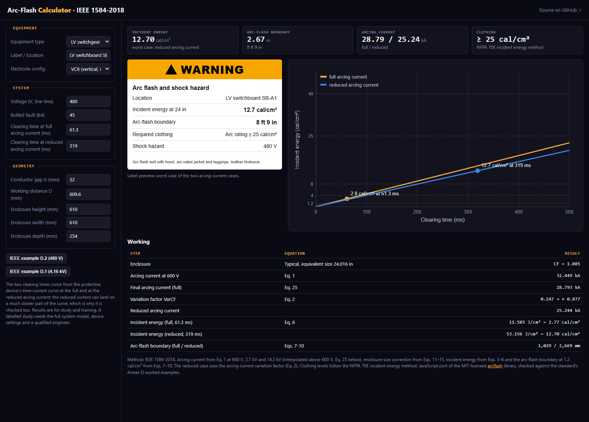

# Arc-flash calculator (IEEE 1584-2018)

Incident energy, arcing current and arc-flash boundary for three-phase AC equipment from 208 V to 15 kV, with the NFPA 70E clothing level and a warning-label preview. One HTML page and one engine file, no build and no server.

**Live:** https://muhammadasadnadeem.vercel.app/tools/arc-flash/index.html

## What it does

- Arcing current at 600 V, 2.7 kV and 14.3 kV (Eq. 1), interpolated above 600 V and corrected below it (Eq. 25)
- Enclosure size correction (Eqs. 11–15, Table 7), typical or shallow
- Incident energy (Eqs. 3–6) and arc-flash boundary at 1.2 cal/cm² (Eqs. 7–10)
- Both the full and the reduced arcing current (variation factor, Eq. 2), each with its own clearing time; the worst case goes on the label
- Equipment presets from Tables 8 and 10 (gap, enclosure size, working distance)
- Range checks: voltage, bolted fault current, gap and working distance

## Checked against the standard

`node tests/annex-d.cjs` runs the two worked examples in IEEE 1584-2018 Annex D (4.16 kV and 480 V): arcing currents, correction factors, incident energies and boundaries all match to the published precision (16 of 16).

## Credit

The engine is a JavaScript port of the [arcflash](https://github.com/LiaungYip/arcflash) Python library by Li-aung Yip (MIT License), which carries the IEEE 1584-2018 coefficient tables.

For study and training. A labelled arc-flash study needs the full system model, the real device settings and a qualified engineer.
